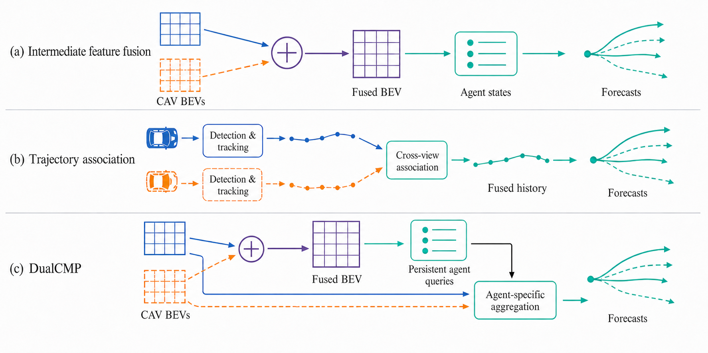

# DualCMP: Cooperative Motion Prediction with Fused and Source-Specific BEV Representations

> **Working manuscript, 2026-08-24.** This draft follows the verified implementation and controlled ablations in `/home/qkb/Project/CoLIF`. BibTeX keys are temporary. The active model uses agent-specific CAV feature fusion without a trajectory-conditioned source refiner.

## Abstract

Predicting the future motion of surrounding agents is essential for safe autonomous driving. Vehicle-to-everything communication improves scene understanding by sharing observations from spatially separated connected and automated vehicles (CAVs). Existing cooperative predictors mainly fuse BEV features for perception or associate tracked trajectories before forecasting. These pipelines improve scene understanding and historical motion representation, respectively. Motion prediction, however, often relies on agent-specific spatial context, and the informative viewpoint may vary across agents because of sensing range and occlusion. We propose **DualCMP**, a cooperative motion prediction framework that uses fused and source-specific BEV features. DualCMP uses the same LiDAR encoding in two ways: fused BEV features update persistent agent queries, while each query aggregates local features from the aligned CAV feature maps. A motion-anchored decoder integrates the cooperative context with motion history and agent interactions to generate multimodal trajectories. Under strict-online evaluation on V2V4Real, the current seed-20 model obtains a 5-s minADE$_6$ of 1.9350 m and minFDE$_6$ of 3.2465 m; attention analysis further shows that its CAV weights vary with observation support and relative geometry. A protocol-matched fused-BEV comparison is still required to attribute a forecasting gain to the source-specific representation.

## I. Introduction

Motion prediction is a core component of autonomous driving because safe planning depends on anticipating the future motion of surrounding agents \cite{zhou2022hivt,zhou2023qcnet}. A predictor uses observed agent states, neighboring agents, and local scene context to generate multiple plausible futures, while occlusion, sparse LiDAR returns, and limited sensing range can make the inputs incomplete \cite{zhou2022hivt,zhou2023qcnet}. Vehicle-to-everything communication provides the receiver with observations from spatially separated connected and automated vehicles (CAVs) \cite{xu2023v2v4real,wang2020v2vnet}. After spatial alignment, CAV observations can extend the receiver's line of sight and supply complementary context for scene understanding and forecasting \cite{wang2020v2vnet,zhou2025v2xpnp}. When forecasting begins, the choice of representation determines which cooperative evidence remains available for a particular target agent.

Existing cooperative motion-prediction methods use CAV observations at different stages and provide different representations to downstream modules. Intermediate-fusion methods encode and align CAV BEV features before detection and tracking, so downstream modules receive a fused BEV for receiver-side scene understanding \cite{wang2020v2vnet,wang2025cmp,zhou2025v2xpnp}. By combining observations from multiple viewpoints in a common frame, the fused BEV representation supports current-state estimation. A second line of work starts from detections, tracks, or historical trajectories produced by separate perception streams and performs cross-view association or trajectory fusion before forecasting, whereas prediction-level methods combine forecast hypotheses produced by separate predictors \cite{yu2023v2xseq,ruan2024v2xgraph,wu2025copad,zhang2025comtp,wang2025cmp,madjid2026latefusion}. Later fusion stages preserve view-specific motion histories or forecast hypotheses, but dense spatial observations have already been converted into boxes, tracks, or trajectory features before the final cooperative representation is formed. Fig. 1 summarizes the main distinction: intermediate fusion forms the fused BEV before agent-state estimation, whereas trajectory fusion begins with view-specific histories after perception and tracking.

*Fig. 1. Cooperative information fusion for motion prediction. (a) Intermediate fusion aggregates aligned CAV BEV features before agent-state estimation and forecasting. (b) Trajectory fusion associates and fuses histories generated by separate detection and tracking pipelines before forecasting. (c) DualCMP uses fused BEV features to update persistent agent queries and aggregates aligned CAV feature maps for agent-centric motion prediction.*

For motion forecasting, the predictor organizes motion history, neighboring agents, and local context around a particular target agent \cite{zhou2022hivt,zhou2023qcnet}. The relevance of different viewpoints can vary across target agents because each agent has a different spatial relation to the observing CAVs. A viewpoint that supplies useful evidence for one agent may be less informative for another agent in the same scene \cite{wang2025cmp,ruan2024v2xgraph}. Intermediate fusion preserves spatial context in the fused BEV, but the source dimension is no longer explicit when a common agent state is formed. Trajectory- and prediction-level fusion preserve view-specific histories or locally generated forecast hypotheses, but their cooperative representations do not expose the dense, receiver-aligned CAV maps after the target reference is established. The resulting interfaces therefore do not allow a downstream predictor to retrieve source-specific spatial features for a particular target, although the common scene representation remains useful for current-state estimation.

To address the limitation, DualCMP retains both representations from a shared LiDAR encoder. FuseBEVT aggregates the aligned CAV BEV features into a fused BEV and uses it to update one persistent query for each traffic agent. After the query is formed, the motion predictor uses the query and its current box as a target reference to retrieve local features from the aligned CAV maps and combines them with relative CAV--agent geometry. The resulting design keeps current-state estimation receiver-centric while providing agent-specific multi-view spatial context for forecasting without maintaining separate tracks for individual CAVs. A motion-anchored decoder combines the cooperative context with ordered motion history and inter-agent interactions to generate multimodal trajectories. Because persistent queries can contain different amounts of observed history and state estimates can be noisy, the decoder derives trajectory anchors from the observed history and predicts residual trajectories around them. We evaluate the complete model under a strict-online protocol and use a fixed-tracking comparison between fused and per-CAV forecasting inputs to test the contribution of source-specific spatial features.

The main contributions are summarized as follows:

1. We present a receiver-side cooperative motion prediction framework that processes online multi-CAV LiDAR observations, updates persistent agent queries from fused BEV measurements, and forecasts from the online states rather than precomputed tracking trajectories.

2. We develop agent-specific CAV feature aggregation that retrieves local aligned BEV features conditioned on the target query and relative CAV-agent geometry, while sharing one LiDAR encoder and keeping a single receiver-side state for each agent.

3. We introduce a motion-anchored forecasting pipeline and a fixed-tracking evaluation that jointly reports tracking, forecast coverage, and trajectory accuracy for matched agent sets under fused and per-CAV forecasting inputs.

The remainder of the paper is organized as follows. Section II reviews related work. Section III defines the cooperative motion prediction problem, Section IV presents DualCMP, and Section V reports the experimental results.

## II. Related Work

### A. Cooperative Perception and Prediction

Cooperative perception methods exchange raw observations, object outputs, or intermediate features to improve receiver-side scene understanding. Intermediate fusion balances spatial context and communication cost and is the perception backbone used by CMP \cite{wang2025cmp}. CMP extends cooperative perception to motion prediction through a modular detection--tracking--prediction pipeline and a second exchange of predicted trajectories. V2XPnP studies one-step spatio-temporal fusion for end-to-end multi-agent perception and prediction \cite{zhou2025v2xpnp}, while UniMM-V2X uses perception-level and prediction-level cooperation with task-specialized representations \cite{souig2026unimm}.

Trajectory-level methods instead start from historical trajectories produced by upstream perception and tracking. PP-VIC fuses vehicle and infrastructure trajectories with CBMOT before applying a trajectory predictor \cite{yu2023v2xseq}. V2X-Graph learns cross-view associations and fuses motion and interaction features \cite{ruan2024v2xgraph}; CoPAD combines Hungarian matching with Kalman filtering for multi-source trajectory fusion \cite{wu2025copad}; and Co-MTP performs trajectory fusion over history and future domains \cite{zhang2025comtp}. ViTraj further learns vehicle-side and infrastructure-side trajectory representations \cite{you2025vitraj}. Prediction aggregation provides a later form of cooperation in CMP and in recent late-fusion work \cite{wang2025cmp,madjid2026latefusion}. DualCMP retains intermediate fusion for persistent state estimation and reuses the aligned CAV feature maps for agent-centric motion prediction.

### B. Agent-Centric Motion Forecasting

Motion predictors commonly combine temporal agent states, local scene context, and social interaction. HiVT separates local context extraction from global agent interaction and uses relative geometric representations \cite{zhou2022hivt}. QCNet uses query-centric encoding and a proposal--refinement decoder in which proposed trajectories provide adaptive anchors for context retrieval \cite{zhou2023qcnet}. DualCMP adopts neither model directly: V2V4Real provides no HD map in the current setup, and DualCMP inputs are online persistent-query states rather than ground-truth trajectory histories. We instead use their architectural principles to organize observed motion history, relative CAV geometry, agent interaction, and multimodal decoding.

### C. Joint Tracking and Forecasting

Persistent object queries have been used to connect detection, tracking, and forecasting in single-vehicle systems. Predicted motion can also support occlusion handling or subsequent perception in methods such as PF-Track and ForeSight \cite{pang2023pftrack,papais2025foresight}. DualCMP instead uses persistent queries to maintain agent identity and treats forecasting as a read-only consumer of the online tracking state.

## III. Problem Formulation

Consider a scene with \(N_t\) available CAVs at time step \(t\), and let \(r\in\{1,\ldots,N_t\}\) denote the receiver. We denote the LiDAR point cloud and pose of CAV \(j\) by \(\mathbf{L}_t^j\) and \(\boldsymbol{\xi}_t^j\), respectively. The relative transformation from CAV \(j\) to receiver \(r\) and the runtime input are

\[
\mathbf{T}_{j\rightarrow r}^t
=\left(\boldsymbol{\xi}_t^r\right)^{-1}\boldsymbol{\xi}_t^j,
\qquad
\mathcal{X}_r^t=
\left(
\left\{\mathbf{L}_t^j,\mathbf{T}_{j\rightarrow r}^t\right\}_{j=1}^{N_t},
\boldsymbol{\xi}_t^r,\tau_t^r
\right),
\tag{1}
\]

where \(\tau_t^r\) is the receiver timestamp. Given \(\mathcal{X}_r^t\) and the state from the previous time step, the task is to estimate the current states of surrounding agents and predict their future trajectories in the receiver coordinate frame. Ground-truth boxes, identities, and future trajectories are used only for training and evaluation and are not included in \(\mathcal{X}_r^t\).

## IV. Method

### A. Framework Overview

DualCMP is an online cooperative motion prediction framework that processes each receiver sequence in temporal order. It contains four main components: cooperative BEV feature encoding, persistent query tracking, agent-specific CAV feature fusion, and multimodal motion prediction. A shared LiDAR encoder produces one BEV feature map for every available CAV. FuseBEVT combines these maps into a fused BEV feature for current object detection and tracking, while the individual CAV features remain available to the motion prediction branch. The two branches therefore share the same LiDAR features but retain different representations for their respective tasks.

The fused BEV feature updates a single persistent state for every tracked agent. After the current agent states have been obtained, each active query extracts local features from the individual CAV maps. The motion predictor combines the aggregated CAV feature with the observed state history and the features of other active agents, and then predicts multiple future trajectories and their probabilities. The individual CAV features are fused once for each agent before the motion modes are constructed; the decoder does not introduce a second source-selection or trajectory-refinement stage. Motion prediction reads the current tracking state but does not modify query assignment, state propagation, or track management.

### B. Cooperative BEV Feature Encoding

Following CMP \cite{wang2025cmp}, we transform the point cloud of every CAV to the current receiver coordinate frame before voxelization. A shared PointPillar encoder \(E_\theta\) maps the transformed point cloud of CAV \(j\) to a BEV feature \(\mathbf{F}_j^t\in\mathbb{R}^{C\times H\times W}\). The CAV features are regrouped according to the number of valid CAVs in each sample and are combined by FuseBEVT:

\[
\mathbf{F}_j^t=E_\theta
\left(\mathbf{T}_{j\rightarrow r}^t\mathbf{L}_t^j\right),
\qquad
\mathbf{F}_{\mathrm{fuse}}^t=
\operatorname{FuseBEVT}
\left(\{\mathbf{F}_j^t\}_{j=1}^{N_t},\mathbf{m}^t\right),
\tag{2}
\]

where \(\mathbf{m}^t\) indicates which CAV features are valid when samples are padded to the same shape. Since all point clouds have already been transformed to the receiver frame, \(\mathbf{F}_j^t\) and \(\mathbf{F}_{\mathrm{fuse}}^t\) use the same BEV grid. No additional spatial transformation is applied after feature encoding.

DualCMP retains both outputs in (2). Classification and box regression heads on \(\mathbf{F}_{\mathrm{fuse}}^t\) produce dense measurement proposals, and the persistent query decoder uses the same fused feature to estimate current agent states. The individual maps \(\{\mathbf{F}_j^t\}\) preserve the CAV dimension and are supplied to the motion prediction branch after tracking. Both branches use one PointPillar encoder; DualCMP neither introduces a second perception backbone nor maintains a separate track for each CAV.

### C. Persistent Query Tracking

At time \(t\), the receiver maintains a fixed-capacity query bank

\[
\mathcal{S}_r^t=
\left\{
\mathbf{q}_i^t,\mathbf{b}_i^t,\mathbf{v}_i^t,
e_i^t,a_i^t,d_i^t,\mathcal{H}_i^t
\right\}_{i=1}^{Q},
\tag{3}
\]

where \(\mathbf{q}_i^t\) is the query feature, \(\mathbf{b}_i^t\in\mathbb{R}^{7}\) is the 3-D box, \(\mathbf{v}_i^t\in\mathbb{R}^{2}\) is the planar velocity, and \(e_i^t\) is the existence logit. The variables \(a_i^t\) and \(d_i^t\) denote the query age and the number of consecutive missing measurements, respectively, while \(\mathcal{H}_i^t\) stores the available query and box history. The recurrent state also records the receiver pose and timestamp so that states can be transformed between consecutive receiver frames. Each active query represents one physical agent rather than one CAV observation.

Before processing a new frame, the previous boxes are transformed to the current receiver frame and propagated with a constant-velocity model. The dense heads on \(\mathbf{F}_{\mathrm{fuse}}^t\) produce current measurement proposals. We apply a distance-gated one-to-one assignment between active queries and valid proposals. Each active query also has a private null assignment, preventing an invalid match from consuming a proposal that is suitable for another query. A matched proposal provides the reference box for an existing query, whereas an unmatched proposal initializes an inactive query slot.

Following the persistent-query formulation used in online tracking \cite{gu2023vip3d}, a deformable-attention decoder updates the query feature and state from the fused BEV feature:

\[
(\widetilde{\mathbf{q}}_i^t,
\widehat{\mathbf{b}}_i^t,
\widehat{\mathbf{v}}_i^t,
\widehat e_i^t)
=D_\phi
\left(
\mathbf{F}_{\mathrm{fuse}}^t,
\mathbf{q}_i^{t,-},
\mathbf{b}_i^{t,-}
\right),
\tag{4}
\]

where the superscript \((- )\) denotes the propagated query and reference box. The existence logit is combined with the dense classification response sampled around the decoded center. A learned measurement gain then combines the propagated box and velocity with the corresponding decoder estimates. Track management activates new queries, retains unmatched queries for a limited number of frames, and releases expired slots. While an unmatched query remains active, its propagated state is appended to the online history. Runtime identities are generated internally and do not correspond to annotation identities. An active query becomes eligible for motion prediction after two valid state entries. Forecast trajectories are not used in the assignment, propagation, measurement update, or track management steps.

### D. Agent-Specific CAV Feature Fusion

The fused BEV feature provides one current state for each agent, but it no longer exposes which CAV contributed a local observation. For motion prediction, DualCMP therefore returns to the individual CAV maps after the target agent has been established. Let \(\mathbf{p}_n\in[-1,1]^2\) denote one of the regular offsets in an \(S\times S\) patch and let \(r_p\) be the patch radius. For agent \(i\), we sample CAV \(j\) at

\[
\mathbf{x}_{in}^t=\mathbf{b}_{i,xy}^t+r_p\mathbf{p}_n,
\qquad
\mathbf{f}_{ijn}^t=
\operatorname{Bilinear}\!\left(\mathbf{F}_j^t,\mathbf{x}_{in}^t\right).
\tag{5}
\]

All CAV maps follow the same receiver BEV grid, so the same metric sampling positions are used for every CAV. The implemented model uses a \(3\times3\) patch with a radius of \(4\) m.

The fusion module also encodes the geometry between the target agent and the observing CAV. The geometry vector \(\mathbf{g}_{ij}^t\in\mathbb{R}^{7}\) contains the normalized relative position and distance, the sine and cosine of the agent-relative bearing, and the sine and cosine of the relative heading. Each sampled feature is projected to the query dimension and combined with the geometry and patch-position embeddings:

\[
\mathbf{z}_{ijn}^t=
W_f\mathbf{f}_{ijn}^t
+G(\mathbf{g}_{ij}^t)
+P(\mathbf{p}_n),
\tag{6}
\]

where \(W_f\), \(G\), and \(P\) are learned projections. The current agent query is used as the attention query, and the CAV patch tokens form the keys and values:

\[
\mathbf{c}_i^t=
\operatorname{LN}_{o}\!\left(
\operatorname{MHA}
\left(
\operatorname{LN}_{q}(\mathbf{q}_i^t),
\{\mathbf{z}_{ijn}^t\}_{j,n},
\{\mathbf{z}_{ijn}^t\}_{j,n}
\right)
\right)
\tag{7}
\]

where unavailable CAVs are masked before the softmax operation and \(\operatorname{LN}_{q}\) and \(\operatorname{LN}_{o}\) denote the query and output normalizations. The model does not use a learned embedding for a fixed CAV index. Instead, the feature of each CAV is identified by its relative geometry. Consequently, a joint permutation of the CAV features, masks, and transformations does not change \(\mathbf{c}_i^t\). The fusion result is computed separately for each active agent and is supplied only to the motion prediction branch; tracking continues to use \(\mathbf{F}_{\mathrm{fuse}}^t\).

### E. Multimodal Motion Prediction

**History encoding.** For each active query, DualCMP stores an ordered sequence of estimated states and a validity mask. Each history state is represented by its relative position, one-step motion, acceleration, box size, heading, observation time, and speed. A temporal Transformer encodes the available history states and produces a history feature \(\mathbf{h}_i^t\). Missing history positions are masked and do not contribute to attention. Since the history is formed online, the encoder uses only states that have been estimated up to the current frame.

Tracking noise can make a velocity estimated from two selected states unstable. We therefore compute the velocity \(\overline{\mathbf{v}}_i^t\) as the median of the valid pairwise velocities in the observed history. We also compute the velocity dispersion \(\sigma_{v,i}^t\) to represent motion variation. The query feature, CAV feature, history feature, motion feature, and current box feature are combined as

\[
\mathbf{u}_i^t=
\operatorname{LN}(\mathbf{q}_i^t)
+\alpha_c\operatorname{LN}(\mathbf{c}_i^t)
+\alpha_h\mathbf{h}_i^t
+M(\overline{\mathbf{v}}_i^t,\sigma_{v,i}^t,n_i^t)
+B(\mathbf{b}_i^t),
\tag{8}
\]

where \(n_i^t\) is the number of valid history states and \(\alpha_c\) and \(\alpha_h\) are bounded learned scales. We then apply a Transformer encoder to the features of all agents that are valid for motion prediction. This step allows each agent to use the current motion features of nearby agents.

**Motion decoder.** We use speed-scaled motion anchors to initialize the future trajectories. For mode \(k\) and future step \(h\), the anchor is

\[
\mathbf{A}_{ikh}=\gamma_k\overline{\mathbf{v}}_i^t h\Delta t,
\tag{9}
\]

where \(\gamma_k\) is the speed scale of mode \(k\). The implemented model uses \(\gamma_k\in\{0,0.5,0.75,1,1.25,1.5\}\). Given the learned mode embedding \(\mathbf{m}_k\), we construct an agent-conditioned mode feature rather than using a purely additive mode token. The prediction heads output a bounded position residual around each anchor, a mode score, two standard deviations, and the correlation of a bivariate Gaussian. Let \(\mathcal{V}_i\) be the valid future steps. The mode feature, predicted mean, and multimodal distribution are

\[
\begin{aligned}
\mathbf{z}_{ik}^t
&=\mathbf{u}_i^t\odot\left(1+\tanh(\mathbf{m}_k)\right)+\mathbf{m}_k,\\
\boldsymbol{\mu}_{ikh}
&=\mathbf{A}_{ikh}+r_{\max}\tanh
\left(\frac{R_h(\mathbf{z}_{ik}^t)}{r_{\max}}\right),\\
\ell_{ik}
&=U_\pi(\mathbf{z}_{ik}^t),
\qquad
\boldsymbol{\Sigma}_{ikh}
&=U_{\Sigma,h}(\mathbf{z}_{ik}^t),
\qquad
\boldsymbol{\pi}_i=\operatorname{softmax}(\boldsymbol{\ell}_i),\\
p(\mathbf{Y}_i\mid\mathbf{u}_i^t)
&=\sum_{k=1}^{K}\pi_{ik}
\prod_{h\in\mathcal{V}_i}
\mathcal{N}
\left(\mathbf{y}_{ih};
\boldsymbol{\mu}_{ikh},\boldsymbol{\Sigma}_{ikh}\right).
\end{aligned}
\tag{10}
\]

The position residual heads are initialized to zero, so the initial trajectory means follow the motion anchors. The decoder also contains a cross-mode layer that exchanges information between motion modes. Both the motion proposal and the cross-mode output are supervised during training, and the motion proposal is used for inference.

### F. Training Losses

We train DualCMP in two phases using receiver sequences in time order. In Phase 1, the shared PointPillar encoder, FuseBEVT, dense detection heads, and persistent query tracker are trained with

\[
\mathcal{L}_{\mathrm{state}}=
\lambda_{\mathrm{det}}(\mathcal{L}_{\mathrm{cls}}+2\mathcal{L}_{\mathrm{reg}})
+\lambda_{\mathrm{exist}}\mathcal{L}_{\mathrm{exist}}
+\lambda_{\mathrm{box}}\mathcal{L}_{\mathrm{box}}
+\lambda_{\mathrm{vel}}\mathcal{L}_{\mathrm{vel}}
+\lambda_{\mathrm{aux}}\mathcal{L}_{\mathrm{aux}}.
\tag{11}
\]

Sequential matching is used only to construct the training losses. A query that has been matched in an earlier frame keeps the same annotation assignment while it remains active. Hungarian matching is applied to unmatched targets and available query slots. Ground-truth identities are not passed to the model state.

In Phase 2, the PointPillar encoder, FuseBEVT, dense measurement path, and persistent query tracker are frozen. We train the agent-specific CAV feature aggregation, history encoder, agent interaction, and motion decoder. For each prediction layer \(l\), the positive mode \(k_i^{*(l)}\) is selected by the distance between the predicted endpoint and the final valid target position. The motion prediction loss is

\[
\mathcal{L}_{\mathrm{motion}}=
\sum_{l=1}^{L}w_l
\left[
\lambda_{\mathrm{gmm}}
\sum_{i}\sum_{h\in\mathcal{V}_i}
-\log\mathcal{N}
\left(
\mathbf{y}_{ih};
\boldsymbol{\mu}_{ik_i^{*(l)}h}^{(l)},
\boldsymbol{\Sigma}_{ik_i^{*(l)}h}^{(l)}
\right)
+\lambda_{\mathrm{mode}}
\sum_i\operatorname{CE}
\left(\boldsymbol{\ell}_i^{(l)},k_i^{*(l)}\right)
\right],
\tag{12}
\]

where \(w_l\) is the loss weight of layer \(l\). The motion proposal and cross-mode output are averaged, corresponding to \(w_1=w_2=0.5\). No source-selection label, availability loss, or trajectory-refinement loss is used.

Freezing the current-state modules in Phase 2 gives all motion prediction variants the same agent queries, boxes, and prediction coverage. During inference, DualCMP processes each receiver sequence in time order, resets the query state at scene boundaries, and predicts trajectories without ground-truth annotations or precomputed tracking trajectories.

## V. Experiments

The experiments examine four questions. First, how accurately does DualCMP forecast under a strict-online protocol? Second, does retaining per-CAV BEV features improve forecasting over a protocol-matched fused-BEV agent patch? Third, does the learned source aggregation vary with the observation support and relative geometry of each agent? Finally, what computational cost and failure modes accompany the additional forecasting representation? Table entries are left blank when a protocol-matched result has not yet been completed.

### A. Experimental Setup

**Dataset and protocol.** We evaluate DualCMP on V2V4Real \cite{xu2023v2v4real}. The local official partition contains 32 training sequences and 9 test sequences. Both vehicles are alternately treated as the receiver, producing 3,420 receiver-centric training clips and 3,986 test frames. The query state is reset at every scene--receiver boundary. At time \(t\), the model receives only the LiDAR observations, poses, and timestamps available up to \(t\); annotation identities, ground-truth boxes, and future trajectories are not passed to the model. We retain at most 11 online states sampled at 10 Hz and predict 50 future steps, corresponding to a 1-s history span and a 5-s prediction horizon. A query becomes eligible for forecasting after two valid state entries.

**Evaluation metrics.** Each method predicts up to six trajectories. We report \(\operatorname{minADE}_{6}\) and \(\operatorname{minFDE}_{6}\) at 1, 3, and 5 s, where lower values indicate better performance. Under the online-masked protocol, ADE is averaged over the valid future positions within the requested horizon, and FDE is evaluated at the last valid position no later than that horizon. We also report the miss rate with a 2-m endpoint threshold, MOTA, center-based MOTP, tracking precision and recall, and forecast coverage. Forecast coverage is the fraction of target agent frames that are matched to an active query with a valid forecast. Complete scene--receiver timelines are assigned to one evaluation rank, and raw metric sums and counts are reduced across ranks before normalization.

**Implementation details.** The PointPillar encoder and FuseBEVT are initialized from the released CMP CoBEVT checkpoint \cite{wang2025cmp}. We first train the fused-BEV persistent tracker and then freeze all current-state modules. In Phase 2, the forecasting modules are trained for 20 epochs with AdamW, an initial learning rate of \(10^{-4}\), a weight decay of \(10^{-4}\), and cosine decay after a two-epoch warm-up. Training uses two NVIDIA RTX 3090 GPUs, two clips per GPU, gradient accumulation over two iterations, mixed precision, and an effective batch size of eight. All controlled variants load the same Phase-1 checkpoint and use the same receiver set, optimization steps, target masks, and data-order seed. The final comparison uses seeds 20, 42, and 2026 and reports the mean and standard deviation. Checkpoints are fixed by training epoch and are not selected on the test set. The dagger in the tables marks the currently available seed-20 result.

### B. Overall Performance

We use two deterministic motion baselines on the same online tracks. Online CV extrapolates the current tracked velocity, whereas Multiscale Anchors uses the six speed scales in Section IV-E without learned residuals. We additionally plan two learned baselines. MTR \cite{shi2022mtr} is retrained from the same persistent-query histories instead of directly transferring weights trained on smoothed offline tracks. CMP \cite{wang2025cmp} is evaluated only after its detection, tracking, target selection, and forecasting outputs have been adapted to the same strict-online evaluator; values obtained from its ground-truth-filtered tracking cache are not inserted into Table I.

\begin{table*}[t]
\centering
\caption{Strict-online results on the V2V4Real test set. ADE and FDE are measured in meters; MOTA and coverage are percentages. All entries use the same receiver set, target construction, and endpoint rule. The dagger denotes the available seed-20 result; the final learned results will be reported as mean $\pm$ standard deviation over three seeds.}
\label{tab:main_results}
\resizebox{\textwidth}{!}{%
\begin{tabular}{llcccccccc}
\hline
Method & Forecast information & MOTA $\uparrow$ & Coverage $\uparrow$ & \multicolumn{3}{c}{minADE$_6$ $\downarrow$} & \multicolumn{3}{c}{minFDE$_6$ $\downarrow$} \\
\cline{5-10}
 & & & & 1 s & 3 s & 5 s & 1 s & 3 s & 5 s \\
\hline
Online CV & Query history & 65.04 & 80.49 & 1.2719 & 2.5910 & 3.8351 & 1.8525 & 4.8452 & 7.5505 \\
Multiscale Anchors & Query history & 65.04 & 80.49 & 0.8626 & 1.4673 & 2.0384 & 1.0797 & 2.3704 & 3.5604 \\
MTR \cite{shi2022mtr} & Query history &  &  &  &  &  &  &  &  \\
CMP \cite{wang2025cmp} & Cooperative perception and prediction &  &  &  &  &  &  &  &  \\
DualCMP (ours)$^{\dagger}$ & Fused and per-CAV BEV & 65.04 & 80.49 & 0.8515 & 1.4083 & 1.9350 & 1.0310 & 2.1841 & 3.2465 \\
\hline
\end{tabular}}
\end{table*}

Table~\ref{tab:main_results} currently supports two comparisons on identical tracks and target masks. Multiscale motion anchors reduce minFDE by 41.71%, 51.08%, and 52.85% relative to online CV at 1, 3, and 5 s, respectively. The learned DualCMP predictor further reduces minFDE by 4.51%, 7.86%, and 8.82% relative to the unlearned anchors. These results show that the motion anchors provide a strong physical initialization and that learned context improves the anchored trajectories. For the current DualCMP run, the 2-m miss rates at 1, 3, and 5 s are 10.78\%, 27.50\%, and 34.18\%; the shared tracker obtains a center-based MOTP of 0.7263 m, 84.86\% precision, and 81.08\% recall. The completed MTR and protocol-matched CMP rows are required before making a broader comparison with learned methods.

### C. Effect of Source-Specific BEV Features

The central ablation changes only the spatial evidence supplied to the forecasting reader. The fused-BEV baseline samples one agent-centered patch from \(\mathbf{F}_{\mathrm{fuse}}^t\). The per-CAV mean baseline retains the aligned source maps but averages their agent-centered features. DualCMP uses the agent query and agent--CAV geometry to aggregate the per-CAV patch tokens. All variants use the same frozen tracker, ordered history, motion anchors, prediction head, and training schedule. The fused and full per-CAV variants also use the same reader parameters; uniform averaging replaces only the source-attention operation while retaining the same feature projection and motion decoder. Tracking outputs and forecast targets are controlled, so the comparison isolates the forecasting representation and aggregation used after tracking.

\begin{table*}[t]
\centering
\caption{Effect of the forecasting representation on V2V4Real. The last three columns report 5-s minFDE$_6$ for receiver-only, partner-only, and shared-support agents. The support groups contain 15,847, 11,902, and 24,848 matched forecast instances, respectively. All variants use the same tracker and evaluation agent set; the dagger denotes the available seed-20 result.}
\label{tab:representation_ablation}
\resizebox{\textwidth}{!}{%
\begin{tabular}{llccccc}
\hline
Forecast representation & Aggregation & minADE$_6$@5s $\downarrow$ & minFDE$_6$@5s $\downarrow$ & Receiver-only & Partner-only & Shared \\
\hline
Fused BEV & Single agent patch &  &  &  &  &  \\
Per-CAV BEV & Uniform mean &  &  &  &  &  \\
Per-CAV BEV & Query and geometry$^{\dagger}$ & 1.9350 & 3.2465 & 2.7109 & 5.0998 & 2.7003 \\
\hline
\end{tabular}}
\end{table*}

Table~\ref{tab:representation_ablation} is the decisive test of the paper's representation claim. A gain over the fused-BEV row tests whether information retained before FuseBEVT remains useful for forecasting. A further gain over uniform averaging tests whether agent-conditioned source selection is preferable to treating all CAV features equally. The support-specific columns locate the effect under asymmetric observations. In particular, an improvement for partner-only agents would show that the retained partner representation supplies forecasting information that is not recovered as effectively from the common fused agent patch. The fused and uniform results are left blank until their protocol-matched 20-epoch evaluations are complete; attention weights alone are not used to fill this causal gap.

### D. Source-Aware Analysis

We first examine whether source aggregation changes with the available observations. Receiver-only, partner-only, and shared support are defined from source-native LiDAR point support and are used only for analysis. The partner attention mass is the sum of the nine patch-token weights assigned to the partner CAV. Figure~\ref{fig:cooperative_analysis}(a) shows that its median is 0.3706 for receiver-only agents, 0.5988 for partner-only agents, and 0.4839 for shared agents. Figure~\ref{fig:cooperative_analysis}(b) groups agents by receiver-to-agent distance minus partner-to-agent distance. The mean partner mass increases from 0.3600 to 0.5642 as agents become relatively closer to the partner. The allocation is therefore neither fixed averaging nor a constant preference for one source. This analysis describes the learned behavior but does not establish that a larger attention weight causes a lower forecast error; that conclusion depends on Table~\ref{tab:representation_ablation}.

\begin{figure*}[t]
\centering
\includegraphics[width=0.78\textwidth]{figures/dualcmp_attention_analysis.pdf}
\caption{Source-aware analysis on the V2V4Real test set. (a) Distribution of partner attention mass for receiver-only, partner-only, and shared-support agents. The center line, box, and whiskers denote the median, interquartile range, and 1.5-IQR range. (b) Mean partner attention mass over five equal-frequency groups of relative agent--CAV distance, plotted at the group mean. The shaded area is a 95\% scene--receiver cluster-bootstrap confidence interval. Positive relative distance means that the agent is closer to the partner CAV. The figure diagnoses source allocation and is not treated as evidence of a causal forecasting gain.}
\label{fig:cooperative_analysis}
\end{figure*}

We additionally visualize the two representations at their actual consumers. Eligible examples have a track age of at least four frames, a complete 5-s future, and at least 5 m of future displacement. For each support group, we build a deterministic candidate reservoir and select the example whose 5-s minFDE is closest to the group median, rather than selecting the lowest-error prediction. Figure~\ref{fig:attention_examples} shows one partner-only agent and one shared agent. The fused-BEV panel contains the objectness response and persistent track used for current-state estimation. The source panels show the local feature magnitude and the nine attention weights around the same agent. The last panel shows the six trajectory means and their mode probabilities.

\begin{figure*}[t]
\centering
\includegraphics[width=\textwidth]{figures/dualcmp_attention_examples.pdf}
\caption{Qualitative visualization of DualCMP on V2V4Real. Each row corresponds to one tracked agent selected by the predefined rule in the text. The fused-BEV column shows the objectness response and persistent state used by tracking. The CAV columns show receiver-aligned agent-centered features; circle area represents a token's attention weight, and each inset reports the mass summed over the nine tokens from that CAV. The final column shows six forecast means, with opacity proportional to mode probability. The source weights form one context shared by all motion modes and are not interpreted as mode-specific explanations.}
\label{fig:attention_examples}
\end{figure*}

### E. Efficiency and Limitations

DualCMP contains 195.68M parameters, of which 4.75M are trainable in Phase 2. The protocol-matched fused-BEV baseline has the same parameter counts because the attention projections do not depend on the number of source tokens. DualCMP also does not change the transmitted feature representation: the receiver already obtains the compressed source features required by FuseBEVT. Retaining and sampling the aligned source maps therefore adds local memory and computation rather than communication payload. Runtime and peak memory will be measured on one RTX 3090 with batch size one and mixed precision, using 1,000 chronological frames after 100 warm-up frames and excluding disk I/O.

The current error analysis identifies two limitations. Partner-only agents form the hardest support group, with a 5-s minFDE of 5.0998 m, compared with 2.7109 m for receiver-only agents and 2.7003 m for shared agents. Short histories are also difficult: agents with two or three observations have a 5-s minFDE of 7.9375 m, whereas agents with at least four observations reach 3.1380 m. These differences describe difficult conditions and do not by themselves show that per-CAV features improve them.

The current evidence is limited to V2V4Real, two synchronous CAVs, and one completed seed for the 20-epoch per-CAV model. The three-seed repetitions, fused-BEV comparison, and protocol-matched learned baselines must be completed before claiming a reproducible advantage over fused forecasting or existing learned methods. The experiments do not support conclusions about asynchronous communication, larger CAV groups, other sensing modalities, or other datasets.

## VI. Conclusion

This paper presented DualCMP, a LiDAR-based framework for cooperative tracking and motion prediction that assigns fused and source-specific BEV representations to different tasks. FuseBEVT supplies common current-state measurements to one persistent query bank, while receiver-aligned per-CAV features are sampled around each tracked agent and aggregated for forecasting. The resulting agent context is combined with ordered online histories, agent interactions, and motion anchors to produce six-mode 5-s trajectories without feeding predicted futures back into tracking. Under the strict-online V2V4Real protocol, the current seed-20 model obtains a 5-s minADE$_6$ of 1.9350 m and minFDE$_6$ of 3.2465 m while maintaining 65.04\% MOTA and 80.49\% forecast coverage. The learned source weights vary with observation support and relative agent--CAV distance, showing that source aggregation does not collapse to fixed averaging. A protocol-matched fused-BEV comparison and additional seeds are still required to determine whether the retained source representation provides a reproducible forecasting advantage. The current study is limited to two synchronous CAVs on one dataset; asynchronous communication and larger cooperative groups remain for future work.

# Working References

[1] R. Xu *et al*., “V2V4Real: A Real-World Large-Scale Dataset for Vehicle-to-Vehicle Cooperative Perception,” in *Proc. IEEE/CVF CVPR*, 2023.

[2] Z. Wang *et al*., “CMP: Cooperative Motion Prediction With Multi-Agent Communication,” *IEEE Robotics and Automation Letters*, vol. 10, no. 4, pp. 3876–3883, 2025.

[3] Z. Zhou *et al*., “V2XPnP: Vehicle-to-Everything Spatio-Temporal Fusion for Multi-Agent Perception and Prediction,” in *Proc. IEEE/CVF ICCV*, 2025.

[4] S. Souig *et al*., “UniMM-V2X: MoE-Enhanced Multi-Level Fusion for End-to-End Cooperative Autonomous Driving,” in *Proc. AAAI*, 2026.

[5] Z. Zhou, J. Wang, Y.-H. Li, and Y.-K. Huang, “Query-Centric Trajectory Prediction,” in *Proc. IEEE/CVF CVPR*, 2023.

[6] Z. Zhou *et al*., “HiVT: Hierarchical Vector Transformer for Multi-Agent Motion Prediction,” in *Proc. IEEE/CVF CVPR*, 2022.

[7] Z. Pang *et al*., “Standing Between Past and Future: Spatio-Temporal Modeling for Multi-Camera 3D Multi-Object Tracking,” in *Proc. IEEE/CVF CVPR*, 2023.

[8] S. Papais *et al*., “ForeSight: Multi-View Streaming Joint Object Detection and Trajectory Forecasting,” in *Proc. IEEE/CVF ICCV*, 2025.

[9] T.-H. Wang *et al*., “V2VNet: Vehicle-to-Vehicle Communication for Joint Perception and Prediction,” in *Proc. ECCV*, 2020.

[10] J. Gu *et al*., “ViP3D: End-to-End Visual Trajectory Prediction via 3D Agent Queries,” in *Proc. IEEE/CVF CVPR*, 2023.

[11] H. Ruan, H. Yu, W. Yang, S. Fan, and Z. Nie, “Learning Cooperative Trajectory Representations for Motion Forecasting,” in *Advances in Neural Information Processing Systems*, 2024.

[12] S. You, L. Weng, and F. Gao, “ViTraj: Learning Dual-Side Representations for Vehicle-Infrastructure Cooperative Trajectory Prediction,” in *Proc. ACM Multimedia*, 2025.

[13] N. A. Madjid *et al*., “Collaborative Trajectory Prediction via Late Fusion,” arXiv:2604.22973, 2026.

[14] H. Yu *et al*., “V2X-Seq: A Large-Scale Sequential Dataset for Vehicle-Infrastructure Cooperative Perception and Forecasting,” in *Proc. IEEE/CVF CVPR*, 2023.

[15] K. Wu, J. Qiao, and Y. Zhang, “CoPAD: Multi-Source Trajectory Fusion and Cooperative Trajectory Prediction With Anchor-Oriented Decoder in V2X Scenarios,” in *Proc. IEEE/RSJ IROS*, 2025.

[16] X. Zhang *et al*., “Co-MTP: A Cooperative Trajectory Prediction Framework With Multi-Temporal Fusion for Autonomous Driving,” in *Proc. IEEE ICRA*, 2025.

[17] S. Shi *et al*., “Motion Transformer With Global Intention Localization and Local Movement Refinement,” in *Advances in Neural Information Processing Systems*, 2022.

# Author Evidence and Citation Ledger

| BibTeX key | Supported statement | Verified evidence |
| --- | --- | --- |
| `xu2023v2v4real` | V2V4Real supplies real multi-vehicle LiDAR viewpoints and cooperative perception sequences. | V2V4Real paper and local dataset; CVPR 2023. |
| `wang2025cmp` | CMP uses cooperative BEV detection, AB3DMOT histories, MTR, and prediction aggregation. | `/home/qkb/Project/Reference/Thesis/Markdown/2025-RAL-Cmp.md`, Secs. IV--V; local code audit. |
| `zhou2025v2xpnp` | V2XPnP performs one-step spatio-temporal intermediate fusion for end-to-end cooperative perception and prediction. | `/home/qkb/Project/Reference/Thesis/Markdown/2025-ICCV-V2XPnP.md`, Secs. 3 and 5. |
| `souig2026unimm` | UniMM-V2X argues for multi-level/task-specialized cooperative representations across perception and prediction. | `/home/qkb/Project/Reference/Paper/Markdown/ALL_MARKDOWN/2026-AAAI-UniMM-V2X.md`, Introduction and multi-level fusion sections. |
| `zhou2022hivt` | HiVT separates local context and global interaction and uses relative geometric invariance. | `/home/qkb/Project/Reference/Paper/Markdown/ALL_MARKDOWN/2022-CVPR-HiVT.md`, Secs. 1 and 3.1. |
| `zhou2023qcnet` | QCNet uses query-centric encoding and proposal-conditioned refinement. | `/home/qkb/Project/Reference/Thesis/Markdown/2023-CVPR-QCNet.md`, Secs. 1, 3.3, and 4.3. |
| `pang2023pftrack` | PF-Track uses predicted future motion in persistent tracking/re-association. | CVPR 2023 paper, Secs. 3.1 and 3.3. |
| `papais2025foresight` | ForeSight maintains multiple-hypothesis forecast memory for subsequent streaming perception/forecasting. | `/home/qkb/Project/Reference/Paper/TXT/2025-ICCV-ForeSight.txt`, Secs. 1 and 3. |
| `wang2020v2vnet` | V2VNet uses spatially aware cross-vehicle aggregation for joint perception and motion forecasting. | `/home/qkb/Project/Reference/Paper/TXT/2020-ECCV-V2VNet.txt`, Abstract and Secs. 1 and 3. |
| `gu2023vip3d` | ViP3D propagates 3-D agent queries through detection, tracking, and trajectory prediction. | `/home/qkb/Project/Reference/Paper/TXT/2023-CVPR-ViP3D.txt`, Abstract and Secs. 1 and 3. |
| `ruan2024v2xgraph` | V2X-Graph constructs forecasting-oriented motion and interaction representations from multi-view cooperative trajectories. | `/home/qkb/Project/Reference/Thesis/Markdown/2024-NeurIPS-V2X-Graph.md`, Introduction and Secs. 4.1--5.3. |
| `you2025vitraj` | ViTraj retains vehicle-side and infrastructure-side trajectory features and performs feature-side selection and cooperative interaction. | `/home/qkb/Project/Reference/Paper/Markdown/ALL_MARKDOWN/2025-ACM-MM-ViTraj.md`, Introduction and Secs. 4.1--4.2. |
| `madjid2026latefusion` | The late-fusion framework retains observer-specific forecasts and combines them after local prediction with temporal alignment and association. | `/home/qkb/Project/Reference/Paper/Markdown/ALL_MARKDOWN/2026-arxiv-Collaborative-Trajectory-Prediction.md`, Introduction and Secs. 3.1--3.2. |
| `yu2023v2xseq` | The PP-VIC baseline fuses vehicle and infrastructure trajectories with CBMOT before TNT or HiVT forecasting. | `/home/qkb/Project/Reference/Paper/Markdown/ALL_MARKDOWN/2023-CVPR-V2X-Seq.md`, Sec. 6.2.1. |
| `wu2025copad` | CoPAD matches multi-source trajectories with the Hungarian algorithm and fuses matched trajectories with Kalman filtering before prediction. | `/home/qkb/Project/Reference/Paper/Markdown/ALL_MARKDOWN/2025-IROS-CoPAD.md`, Secs. III-A--III-B. |
| `zhang2025comtp` | Co-MTP preprocesses vehicle and infrastructure histories and performs multi-temporal trajectory fusion in a heterogeneous graph. | `/home/qkb/Project/Reference/Paper/Markdown/ALL_MARKDOWN/2025-ICRA-Co-MTP.md`, Secs. III-B--III-D. |
| `shi2022mtr` | MTR uses intention queries and iterative local movement refinement for six-mode motion prediction. | `/home/qkb/Project/Reference/Thesis/Markdown/2022-NeurIPS-Motion-transformer-with-global-intention-localization-and-local-movement-refinem.md`, Secs. 3.2 and 4.3. |

Before submission, the working references must be converted to a verified BibTeX database. The current official-test monitoring policy must be disclosed: no validation split is used, test metrics are recorded after each fixed epoch, and checkpoints are not automatically selected by test score.
